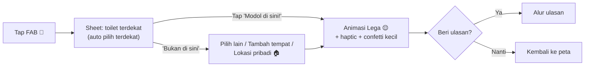

# 🎨 Modoltracker: Design System & UI/UX Guide

> **Wajib dibaca sebelum membuat UI apa pun.** Dokumen ini melengkapi [PROJECT_BLUEPRINT.md](./PROJECT_BLUEPRINT.md).
> Gaya: **Playful & cerah ala Duolingo (Konsep A)**, tetapi dengan identitas Modoltracker sendiri, bukan tiruan.
> Jika ada konflik dengan bagian Desain & Branding di blueprint, **dokumen ini yang berlaku**.

---

## Daftar Isi
1. [Kepribadian Visual](#1-kepribadian-visual)
2. [Anti AI-Slop Rules](#2-anti-ai-slop-rules)
3. [Design Tokens](#3-design-tokens)
4. [Ikon & Ilustrasi](#4-ikon--ilustrasi)
5. [Maskot "Si Modi"](#5-maskot-si-modi)
6. [Komponen](#6-komponen)
7. [Layar Kunci & Alur UX](#7-layar-kunci--alur-ux)
8. [Motion & Micro-interaction](#8-motion--micro-interaction)
9. [Copywriting & Tone](#9-copywriting--tone)
10. [Aksesibilitas](#10-aksesibilitas)
11. [Referensi](#11-referensi)
12. [Checklist Review UI](#12-checklist-review-ui)

---

## 1. Kepribadian Visual

| Kami adalah | Kami bukan |
|---|---|
| **Chunky**: bentuk tebal, tombol "empuk" 3D | Tipis, minimalis korporat |
| **Cerah & berani**: warna jenuh, kontras jelas | Pastel pucat, gradien ungu-biru |
| **Lucu tapi bersih**: kartun imut | Jorok, foto kotoran, humor menjijikkan |
| **Merayakan hal kecil**: animasi setelah check-in | Datar tanpa feedback |
| **Lokal Indonesia**: gayung, jongkok, SPBU, mudik | Generik, terasa terjemahan |
| **Cepat dipakai saat darurat** | Banyak langkah dan dialog |

**Tiga kata kunci:** *Empuk · Ceria · Lega* 😌

**Formula visual Duolingo yang kita adopsi (prinsipnya, bukan asetnya):**
1. Permukaan dipisahkan dengan **border tebal 2px**, bukan bayangan blur.
2. Tombol dan kartu interaktif punya **"bibir" bawah solid** (offset shadow tanpa blur) yang turun saat ditekan.
3. Tipografi **bulat dan tebal** untuk heading.
4. Warna dipakai secara **fungsional** (setiap warna punya arti).
5. **Maskot** muncul di momen emosional: sukses, kosong, error, darurat.

---

## 2. Anti AI-Slop Rules

❌ **DILARANG**
- Gradien ungu/biru/pink sebagai background atau tombol
- Glassmorphism, blur backdrop dekoratif, efek "glow" neon
- Bayangan blur lembut (`shadow-lg`, `shadow-xl`) di semua kartu
- Font Inter/Roboto/system default untuk heading
- Emoji teks sebagai ikon UI utama (emoji hanya untuk reaksi & copy)
- Ikon Lucide default tanpa penyesuaian (ciri khas template shadcn)
- Layout landing generik: hero, 3 kolom fitur, testimonial, CTA
- Copy generik: "Revolutionize", "Seamless", "Unlock", "Elevate", "Your journey starts here"
- Semua elemen dalam card dengan ukuran sama (grid monoton)
- Placeholder abu-abu kosong untuk empty state (wajib ilustrasi + copy)
- Spinner polos untuk loading lebih dari 300 ms (gunakan skeleton atau animasi maskot)
- Warna di luar token

✅ **WAJIB**
- Semua warna, radius, spacing, dan shadow **hanya dari token** (bagian 3)
- Setiap aksi utama memberi **feedback** (animasi, haptic, toast)
- Setiap layar punya **satu aksi utama** yang paling menonjol
- Empty, loading, dan error state didesain, bukan sisa
- Copy dalam Bahasa Indonesia santai sesuai bagian 9

---

## 3. Design Tokens

### 3.1 Warna

**Brand & fungsional** (setiap warna punya pasangan `-shade` untuk "bibir" 3D):

| Token | Hex | Shade | Arti / Pemakaian |
|---|---|---|---|
| `sunny` | `#FFC800` | `#E0A500` | **CTA utama** ("Modol di sini!"), highlight, XP |
| `choco` | `#8A5A3B` | `#5C3A22` | Brand, logo, maskot, teks heading spesial |
| `splash` | `#1CB0F6` | `#1593CF` | Air & kebersihan, link, info, rating kebersihan |
| `fresh` | `#4CC764` | `#3AA14F` | Sukses, terverifikasi, rating bagus, buka |
| `cherry` | `#FF4B4B` | `#D93636` | Darurat, error, rating buruk, tutup |
| `bubble` | `#FF7EB6` | `#E0609A` | Sosial: teman, reaksi, leaderboard |
| `grape` | `#A570FF` | `#8452DB` | Badge langka / premium (pemakaian hemat!) |

**Netral (hangat, bukan abu-abu dingin):**

| Token | Hex | Pemakaian |
|---|---|---|
| `ink` | `#3C2A1E` | Teks utama |
| `ink-soft` | `#7A6656` | Teks sekunder |
| `ink-faint` | `#B3A393` | Placeholder, disabled |
| `line` | `#EADFCC` | Border default |
| `line-strong` | `#D6C6AD` | Border hover / bibir kartu |
| `cream` | `#FFF8EC` | Background aplikasi |
| `paper` | `#FFFFFF` | Permukaan kartu |
| `sand` | `#F6ECDA` | Permukaan sekunder, input |

**Dark mode** *(Fase 2)*: background `#1F1610`, permukaan `#2C2018`, border `#4A3829`, teks `#F6ECDA`. Warna fungsional tetap, dengan shade lebih gelap.

**Aturan warna:**
- Teks di atas `sunny` → selalu `ink` (bukan putih).
- Teks di atas `splash`, `fresh`, `cherry`, `choco`, `grape` → putih.
- Maksimal **2 warna fungsional** dalam satu layar selain netral (kecuali peta).

### 3.2 Warna Pin Peta (berdasarkan rating)
| Rating | Warna |
|---|---|
| ≥ 4.0 | `fresh` |
| 3.0 – 3.9 | `sunny` |
| < 3.0 | `cherry` |
| Belum ada ulasan | `ink-faint` |
| Check-in milik sendiri (peta jejak) | `choco` |
| Check-in teman | `bubble` |

### 3.3 Tipografi

| Peran | Font | Bobot | Sumber |
|---|---|---|---|
| Display & heading | **Baloo 2** | 700, 800 | Google Fonts |
| Body & UI | **Nunito** | 500, 700, 800 | Google Fonts |
| Angka / statistik | **Baloo 2** | 800 (tabular) | Google Fonts |

Skala (mobile → desktop):

| Token | Ukuran / line-height | Pemakaian |
|---|---|---|
| `display` | 36/40 → 48/52 | Angka besar statistik, Wrapped |
| `h1` | 28/34 → 32/38 | Judul layar |
| `h2` | 22/28 | Judul section |
| `h3` | 18/24 | Judul kartu |
| `body` | 16/24 | Teks utama (**minimal 16px** di mobile) |
| `small` | 14/20 | Meta info |
| `caption` | 12/16, uppercase, tracking 0.06em, bobot 800 | Label kecil, chip |

### 3.4 Spacing, Radius, Border, Shadow

- **Spacing:** kelipatan 4 → `4, 8, 12, 16, 20, 24, 32, 40, 48, 64`. Padding layar mobile = 16, desktop = 24.
- **Radius:** `sm 8` (chip) · `md 12` (input) · `lg 16` (tombol, kartu) · `xl 24` (bottom sheet, modal) · `full` (avatar, FAB).
- **Border:** default `2px solid line`. Elemen terpilih: `2px solid splash` + latar `splash/10%`.
- **Shadow "bibir" (satu-satunya jenis shadow):**
  ```css
  --lip-sm: 0 2px 0 var(--shade);   /* chip, kartu kecil */
  --lip-md: 0 4px 0 var(--shade);   /* tombol, kartu */
  --lip-lg: 0 6px 0 var(--shade);   /* FAB */
  ```
  Satu-satunya pengecualian blur: bottom sheet di atas peta → `0 -8px 24px rgba(60,42,30,.12)`.

### 3.5 Tailwind Preset (`packages/config/tailwind-preset.ts`)

```ts
export default {
  theme: {
    extend: {
      colors: {
        sunny:  { DEFAULT: '#FFC800', shade: '#E0A500' },
        choco:  { DEFAULT: '#8A5A3B', shade: '#5C3A22' },
        splash: { DEFAULT: '#1CB0F6', shade: '#1593CF' },
        fresh:  { DEFAULT: '#4CC764', shade: '#3AA14F' },
        cherry: { DEFAULT: '#FF4B4B', shade: '#D93636' },
        bubble: { DEFAULT: '#FF7EB6', shade: '#E0609A' },
        grape:  { DEFAULT: '#A570FF', shade: '#8452DB' },
        ink:    { DEFAULT: '#3C2A1E', soft: '#7A6656', faint: '#B3A393' },
        line:   { DEFAULT: '#EADFCC', strong: '#D6C6AD' },
        cream: '#FFF8EC', paper: '#FFFFFF', sand: '#F6ECDA',
      },
      fontFamily: {
        display: ['"Baloo 2"', 'system-ui', 'sans-serif'],
        sans:    ['Nunito', 'system-ui', 'sans-serif'],
      },
      borderRadius: { sm: '8px', md: '12px', lg: '16px', xl: '24px' },
      boxShadow: {
        'lip-sm': '0 2px 0 var(--lip-color)',
        'lip-md': '0 4px 0 var(--lip-color)',
        'lip-lg': '0 6px 0 var(--lip-color)',
        sheet:    '0 -8px 24px rgba(60,42,30,.12)',
      },
    },
  },
};
```
Token yang sama diekspor sebagai objek TS dari `packages/ui/tokens.ts` untuk dipakai di mobile (NativeWind) dan OG image.

---

## 4. Ikon & Ilustrasi

### 4.1 Apakah ikon harus dibuat sendiri dulu?
**Tidak.** Hampir semua kebutuhan ikon dipenuhi oleh library open-source berkualitas tinggi. Yang perlu dibuat khusus hanya aset identitas, dan itu **tidak menghalangi development** karena bisa memakai placeholder dulu.

| Aset | Perlu buat sendiri? | Solusi sementara |
|---|---|---|
| Ikon UI (navigasi, tombol, form) | ❌ Tidak | **Phosphor Icons** |
| Ikon fasilitas & kategori | ❌ Tidak | Phosphor (+ beberapa SVG kecil buatan sendiri, lihat 4.4) |
| Reaksi & badge | ❌ Tidak (awal) | **Microsoft Fluent Emoji 3D** di dalam bingkai badge |
| Animasi celebrasi | ❌ Tidak | **LottieFiles** (cek lisensi) atau confetti via kode |
| **Logo / app icon** | ✅ Ya | Wordmark Baloo 2 + emoji 💩 Fluent sementara |
| **Maskot Si Modi** | ✅ Ya (disarankan) | Fluent Emoji "Pile of Poo" 3D sebagai placeholder |
| Ilustrasi empty state | ⚠️ Idealnya | Maskot placeholder + copy |

### 4.2 Library Ikon Utama: **Phosphor Icons** ⭐
- Web: `@phosphor-icons/react` · Mobile: `phosphor-react-native` · Lisensi MIT · https://phosphoricons.com
- Alasan: punya 6 weight. Weight **Bold** dan **Fill** cocok dengan gaya chunky; lebih berkarakter daripada Lucide.
- **Aturan pemakaian:**
  - Default weight: **`bold`**, ukuran 24 (navigasi 28).
  - State aktif / terpilih: **`fill`**.
  - Ikon dekoratif besar (empty state kecil, header): **`duotone`** dengan warna fungsional.
  - Jangan campur library ikon lain di UI yang sama.

**Pemetaan ikon awal:**

| Konteks | Phosphor Icon |
|---|---|
| Peta | `MapTrifold` |
| Teman | `UsersThree` |
| Profil | `UserCircle` |
| Badge / pencapaian | `Medal` |
| Feed | `Lightning` |
| Leaderboard | `Trophy` |
| Lokasi saya | `Crosshair` |
| Filter | `SlidersHorizontal` |
| Cari | `MagnifyingGlass` |
| Navigasi | `NavigationArrow` |
| Darurat | `Siren` |
| Mode Mudik | `Car` / `Path` |
| Notifikasi | `Bell` |
| Pengaturan | `GearSix` |
| Privasi publik / teman / privat | `GlobeHemisphereEast` / `UsersThree` / `LockSimple` |
| Zona privat | `HouseLine` |
| Report | `Flag` |
| SPBU | `GasPump` |
| Minimarket | `Storefront` |
| Masjid / mushola | `Mosque` |
| Mall | `ShoppingBag` |
| Restoran / kafe | `ForkKnife` / `Coffee` |
| Rest area | `Signpost` |
| Toilet umum | `Toilet` |
| Rumah sakit | `FirstAidKit` |
| Stasiun / bandara | `Train` / `AirplaneTilt` |
| Kebersihan | `Sparkle` |
| Air | `Drop` |
| Tisu | `ToiletPaper` |
| Sabun / wastafel | `HandSoap` |
| Disabilitas | `Wheelchair` |
| Ganti popok | `Baby` |
| Shower | `Shower` |
| Gratis / berbayar | `Coins` |
| Jam buka | `Clock` |
| Kamera / foto | `Camera` |

### 4.3 Emoji 3D: **Microsoft Fluent Emoji**
- https://github.com/microsoft/fluentui-emoji (MIT). Gunakan versi **3D** (PNG) untuk:
  - Reaksi: 💩 😂 🫡 🤢 (ditampilkan sebagai gambar 3D, bukan emoji sistem, agar konsisten di semua device)
  - Isi badge (di dalam bingkai badge kustom)
  - Ilustrasi sementara sebelum maskot jadi
- Simpan di `apps/web/public/emoji/` dengan nama `poo.png`, `joy.png`, `salute.png`, `nauseated.png`, dll.

### 4.4 Ikon Kustom yang Perlu Dibuat (kecil, SVG, bisa belakangan)
Konsep lokal yang tidak ada di library:

| Ikon | Keterangan |
|---|---|
| `squat-toilet` | Toilet jongkok |
| `gayung` | Gayung air |
| `jet-washer` | Semprotan bidet |
| `pin-modol` | Bentuk pin peta khas (tetesan dengan bibir 3D) |

Gaya wajib: **stroke 2px setara Phosphor Bold**, sudut membulat, grid 24×24, satu warna (`currentColor`). Sampai dibuat: gunakan `Toilet`, `Drop`, `Drop` + label teks.

### 4.5 Pin Peta Kustom
Dibuat dengan **kode** (SVG komponen), bukan gambar:
```
   ╭───────╮
   │  ⛽   │  ← ikon kategori Phosphor Fill, putih
   ╰──┬────╯  ← body warna rating, border 2px putih, bibir shade 3px
      ▼
```
- Ukuran 36px (normal), 44px (terpilih, bounce).
- Cluster: lingkaran `choco` + angka Baloo 2 putih + border putih 3px.

### 4.6 Badge
- Bentuk **bingkai heksagon membulat** (SVG kode) dengan warna sesuai tier:
  - Tier 1 perunggu `#D9894B` · Tier 2 perak `#B8C4CE` · Tier 3 emas `sunny` · Langka `grape`
- Isi: Fluent Emoji 3D atau ikon Phosphor Fill.
- Badge yang belum didapat: grayscale + ikon `LockSimple` kecil.

---

## 5. Maskot "Si Modi"

**Konsep:** karakter tumpukan 💩 kartun yang **imut, bulat, berwarna `choco`** dengan pipi merah muda (`bubble`), mata besar berkilau, dan kadang memegang gayung. Kesannya menggemaskan, bukan menjijikkan.

| Pose | Dipakai di |
|---|---|
| 😊 Senyum melambai | Onboarding, landing |
| 😌 Lega (mata terpejam, keringat hilang) | Sukses check-in |
| 😰 Panik berkeringat | Mode Darurat, error |
| 😴 Tidur | Empty state |
| 🎉 Merayakan + confetti | Dapat badge, Wrapped |
| 🧐 Memegang kaca pembesar | Pencarian tidak ditemukan |
| 🔒 Memegang gembok | Pengaturan privasi |

**Pembuatan:** idealnya dibuat ilustrator (Fiverr/Upwork/Behance, ilustrator lokal) dalam format **SVG / Lottie**, atau dibuat versi konsep dengan AI image generator lalu di-vectorize & dirapikan manual. Selama belum ada, pakai Fluent Emoji 💩 3D.

**Spesifikasi logo / app icon:**
- App icon: Si Modi di latar `sunny`, tanpa teks, sudut aman 20%.
- Wordmark: "modoltracker" huruf kecil, Baloo 2 ExtraBold, warna `choco`, huruf "o" pertama diganti siluet Si Modi.

---

## 6. Komponen

### 6.1 Button (komponen paling penting)

| Varian | Warna | Pemakaian |
|---|---|---|
| `primary` | `sunny` + teks `ink` | Aksi utama layar |
| `secondary` | `paper` + border `line` + teks `splash` | Aksi kedua |
| `success` | `fresh` | Konfirmasi |
| `danger` | `cherry` | Hapus, darurat |
| `ghost` | transparan + teks `ink-soft` | Aksi tersier |

Spesifikasi:
- Tinggi 52 (lg), 44 (md), 36 (sm). Radius `lg`. Font Nunito 800, **UPPERCASE**, tracking 0.04em.
- Bibir: `shadow-lip-md` dengan warna shade varian.
- **Ditekan:** `translateY(4px)` + shadow 0, durasi 80 ms. Inilah "rasa empuk".
- Disabled: latar `sand`, teks `ink-faint`, tanpa bibir.
- Lebar penuh di mobile untuk CTA utama.

```tsx
// Pola dasar (Tailwind)
<button className="h-[52px] rounded-lg bg-sunny px-6 font-extrabold uppercase tracking-wide
  text-ink shadow-lip-md [--lip-color:theme(colors.sunny.shade)]
  active:translate-y-1 active:shadow-none transition-transform duration-75">
  Modol di sini!
</button>
```

### 6.2 FAB "Modol di Sini" 💩
- Lingkaran 72px, `sunny`, `shadow-lip-lg`, ikon Si Modi / Fluent 💩 di tengah.
- Posisi: tengah bawah, menonjol 50% di atas bottom nav.
- Idle: animasi "napas" halus (scale 1 → 1.04, 2,4 detik, loop). Matikan jika `prefers-reduced-motion`.
- Long-press: langsung check-in di toilet terdekat yang terpilih (shortcut power user).

### 6.3 Card
- `paper`, border 2px `line`, radius `lg`, padding 16.
- Kartu interaktif: tambah `shadow-lip-sm` dengan warna `line-strong`, lalu efek tekan seperti tombol.
- **Place Card** (list toilet):
  ```
  ┌────────────────────────────────────────┐
  │ [ikon kategori]  SPBU Pertamina 34.123 │
  │  bulat 40px      ⭐ 4.6 · 230 m · Buka  │
  │                  [Gratis] [Jongkok] [💧]│
  └────────────────────────────────────────┘
  ```
  Rating ditampilkan dengan **chip warna rating** (bukan sekadar teks).

### 6.4 Rating Input: "Gulungan Tisu" 🧻
Pembeda khas Modoltracker: rating memakai **5 gulungan tisu** (ikon kustom atau `ToiletPaper` Fill), bukan bintang.
- Ukuran ikon 40px, jarak 8px, area sentuh ≥ 44px.
- Terpilih: warna kategori (kebersihan `splash`, air `splash`, privasi `fresh`, bau `bubble`, kelengkapan `sunny`) + animasi pop.
- Label dinamis di bawah: 1 "Parah 😵" · 2 "Kurang" · 3 "Lumayan" · 4 "Bersih!" · 5 "Kinclong ✨".
- Tampilan baca (read-only) di kartu: angka + 1 ikon kecil saja, untuk menghemat ruang.

### 6.5 Chip / Tag
- Tinggi 32, radius `full`, border 2px, font Nunito 700 14px.
- Filter terpilih: latar `splash/10%`, border `splash`, teks `splash`, ikon `fill`.

### 6.6 Bottom Navigation
- Tinggi 64 + safe area, latar `paper`, border atas 2px `line`.
- 4 tab + FAB di tengah: **Peta · Teman · [FAB] · Pencapaian · Profil**.
- Aktif: ikon `fill` warna `splash` + label 800; tidak aktif: ikon `bold` `ink-faint`, tanpa label (atau label 700 `ink-faint`).

### 6.7 Bottom Sheet (di atas peta)
- Radius atas `xl`, handle 40×5 `line-strong`, `shadow-sheet`.
- 3 snap point: peek (20%: nama + rating), half (50%: detail), full (90%).
- Library: `vaul` (web) / `@gorhom/bottom-sheet` (mobile).

### 6.8 Input
- Tinggi 52, latar `sand`, border 2px `line`, radius `md`.
- Focus: border `splash`, latar `paper`. Error: border `cherry` + pesan di bawah dengan ikon `WarningCircle`.

### 6.9 Toast
- Muncul di atas, radius `lg`, border 2px, bibir. Sukses `fresh`, error `cherry`, info `splash`. Selalu dengan ikon. Durasi 3 detik.

### 6.10 Avatar & Teman
- Lingkaran, border 3px `paper` + ring 2px warna (teman = `bubble`).
- Avatar default: Si Modi dengan aksesori acak (topi, kacamata, gayung) berwarna-warni, bukan inisial abu-abu.

### 6.11 Stat Tile (profil)
```
┌──────────┐
│   127    │ ← Baloo 2 800, display, warna fungsional
│ CHECK-IN │ ← caption
└──────────┘
```
Grid 3 kolom; setiap tile warna berbeda (`sunny`, `splash`, `fresh`) untuk angka.

---

## 7. Layar Kunci & Alur UX

### 7.1 Prinsip UX
1. **Check-in ≤ 3 tap** dari membuka aplikasi.
2. **Peta adalah beranda.** Tidak ada halaman dashboard terpisah.
3. **Progressive disclosure:** info penting di permukaan, detail di bottom sheet.
4. **Tanpa login untuk melihat peta.** Login hanya diminta saat beraksi (check-in, ulasan).
5. **Satu pertanyaan per layar** di alur ulasan (gaya Duolingo).
6. **Thumb zone:** semua aksi utama di 40% bawah layar.

### 7.2 Peta (Beranda)
```
┌─────────────────────────────┐
│ [🔍 Cari toilet...]  [⚙︎]    │ ← search bar mengambang, radius full
│ [Gratis][Buka][⭐4+][SPBU] → │ ← chip filter, scroll horizontal
│                             │
│        PETA + PIN           │
│                      [◎]    │ ← tombol lokasi saya
│ ┌─────────────────────────┐ │
│ │ ▬  3 toilet bagus dekat │ │ ← bottom sheet peek
│ └─────────────────────────┘ │
│ [Peta][Teman] (💩) [🏅][👤] │
└─────────────────────────────┘
```
- Tile peta: gunakan style **hangat & bersih** (mis. MapTiler "Streets" yang disesuaikan, atau CARTO Voyager). Hindari style default OSM yang ramai.

### 7.3 Alur Check-in

- Pilihan visibility tampil sebagai chip kecil di sheet (default dari pengaturan), bukan langkah terpisah.

### 7.4 Alur Ulasan (gaya kuis Duolingo)
- Progress bar `fresh` tebal (12px, radius full) di atas.
- Satu kategori per layar: ikon besar, pertanyaan ("Seberapa bersih toiletnya?"), rating gulungan tisu, auto-lanjut 400 ms setelah memilih.
- Layar terakhir: chip fasilitas (multi-select) + teks opsional.
- Selesai: Si Modi merayakan + "+10 XP" (XP disiapkan untuk gamifikasi Fase 2).

### 7.5 Detail Toilet
- Header: ikon kategori besar dalam lingkaran berwarna, nama (h1), alamat, status buka.
- **Skor besar** (Baloo 2 display) + bar per kategori (bar tebal 10px warna kategori).
- Grid fasilitas (ikon + label, yang tidak tersedia dicoret abu-abu).
- CTA sticky bawah: `[NAVIGASI]` secondary + `[MODOL DI SINI!]` primary.
- Ulasan: kartu dengan avatar, rating chip, badge "✅ Di lokasi", reaksi.

### 7.6 Profil & Peta Jejak
- Header: avatar besar, nama, title ("Raja SPBU" chip `sunny`), tombol tambah teman.
- Stat tile 3 kolom → peta jejak mini (tap untuk layar penuh) → badge terbaru (scroll horizontal) → aktivitas.

### 7.7 Teman
- Tab: **Teman · Permintaan (badge angka `cherry`) · Cari**.
- Kartu teman: avatar, nama, "Terakhir modol di Bandung · 2 hari lalu", tombol "Lihat jejak".

### 7.8 Mode Darurat 🚨 *(Fase 3)*
- Latar `cherry` layar penuh, Si Modi panik, satu tombol raksasa putih "ANTAR AKU KE TOILET!".
- Menampilkan 1 hasil terbaik saja (nama, jarak, waktu tempuh) + "Coba yang lain".
- Tanpa animasi panjang. Kecepatan adalah fitur.

### 7.9 Empty, Loading, Error
| State | Desain |
|---|---|
| Empty peta jejak | Si Modi tidur + "Belum ada jejak. Petualangan modolmu dimulai dari sini!" + CTA |
| Empty teman | Si Modi melambai + "Modol sendirian itu sepi. Ajak temanmu!" + CTA undang |
| Loading peta | Skeleton pin berdenyut |
| Loading lain | Skeleton dengan warna `sand` |
| Offline | Banner `sunny`: "Sinyal hilang. Menampilkan data tersimpan." |
| Error | Si Modi panik + "Waduh, ada yang mampet 😅" + tombol "Coba lagi" |
| Izin lokasi ditolak | Ilustrasi + penjelasan manfaat + tombol buka pengaturan |

---

## 8. Motion & Micro-interaction

**Library:** `motion` (Framer Motion) di web · `react-native-reanimated` + `moti` di mobile · `lottie-react` / `lottie-react-native` untuk animasi maskot · `canvas-confetti` untuk confetti.

| Token | Durasi | Easing | Pemakaian |
|---|---|---|---|
| `instant` | 80 ms | ease-out | Tekan tombol |
| `quick` | 150 ms | ease-out | Hover, toggle |
| `base` | 250 ms | `cubic-bezier(.2,.8,.2,1)` | Sheet, modal, halaman |
| `bounce` | 400 ms | spring (stiffness 400, damping 15) | Pin terpilih, rating pop, badge |
| `celebrate` | 1200 ms | spring | Sukses check-in, badge baru |

**Momen yang wajib punya micro-interaction:**
1. Tekan tombol → turun 4px (bibir hilang).
2. Pilih rating → gulungan tisu "pop" (scale 1 → 1.3 → 1) + haptic ringan.
3. **Check-in sukses** → Si Modi lega + confetti warna token + haptic sukses + suara "plung" 💧 opsional (default OFF, bisa dinyalakan di pengaturan).
4. Dapat badge → badge jatuh dari atas, berputar, berkilau.
5. Tap pin → pin membesar dan bounce, sheet naik.
6. Tarik untuk refresh → Si Modi meloncat.
7. Reaksi → emoji 3D melayang ke atas.

**Aksesibilitas motion:** hormati `prefers-reduced-motion`. Ganti animasi besar dengan fade 150 ms, dan matikan loop "napas".

---

## 9. Copywriting & Tone

**Suara:** teman yang lucu dan suportif. Bahasa Indonesia santai (pakai "kamu"), boleh plesetan, **tidak vulgar**.

| Konteks | ✅ Pakai | ❌ Hindari |
|---|---|---|
| CTA check-in | "Modol di sini!" | "Submit check-in" |
| Sukses check-in | "Lega ya! 😌 Jejakmu tercatat." | "Check-in berhasil disimpan." |
| Ulasan | "Seberapa bersih toiletnya?" | "Silakan beri penilaian kebersihan." |
| Error | "Waduh, ada yang mampet. Coba lagi ya!" | "Error 500: Internal Server Error" |
| Izin lokasi | "Biar kami bisa nunjukin toilet terdekat pas kamu kebelet 🏃" | "Aplikasi memerlukan akses lokasi." |
| Hapus akun | "Yakin mau pergi? Semua jejakmu akan hilang selamanya." | Copy lucu (momen serius = tone serius) |
| Privasi | Jelas dan serius, tanpa bercanda | Humor di pengaturan keamanan |

**Kosakata khas:** *kebelet, lega, jejak, modol, kinclong, mampet, SPBU, gayung, jongkok*.
**Aturan:** humor di momen ringan; **tone serius** untuk privasi, keamanan, hapus akun, dan laporan.

---

## 10. Aksesibilitas

- Kontras teks minimal **WCAG AA** (4.5:1 body, 3:1 teks besar). Teks `ink` di atas `sunny` ✅; teks putih di atas `sunny` ❌.
- Target sentuh ≥ **44×44 px**.
- Warna **tidak boleh jadi satu-satunya penanda**: pin rating juga menampilkan angka saat di-zoom; status buka/tutup memakai teks.
- Semua ikon tanpa label wajib punya `aria-label`.
- Mendukung font scaling sistem hingga 200% tanpa layout rusak.
- Focus ring terlihat: `2px splash` + offset 2px.
- Alur check-in bisa diselesaikan dengan screen reader.

---

## 11. Referensi

### Inspirasi (pelajari prinsipnya, jangan menyalin aset)
| Aplikasi | Pelajari |
|---|---|
| **Duolingo** | Tombol 3D, maskot, celebrasi, alur satu-pertanyaan, gamifikasi |
| **Gojek / GoPay** | Ilustrasi lokal Indonesia, tone ramah |
| **Waze** | Laporan komunitas real-time, peta yang ceria |
| **Strava** | Peta jejak, statistik, feed sosial, share card |
| **Headspace** | Ilustrasi karakter yang hangat |
| **Finch** | Maskot imut + micro-celebration |
| **Spotify Wrapped** | Story card rekap tahunan |

### Sumber Aset
| Sumber | Kegunaan | Lisensi |
|---|---|---|
| [Phosphor Icons](https://phosphoricons.com) | Ikon UI utama | MIT |
| [Fluent Emoji](https://github.com/microsoft/fluentui-emoji) | Emoji 3D, badge, placeholder maskot | MIT |
| [LottieFiles](https://lottiefiles.com) | Animasi (cek lisensi per aset) | Bervariasi |
| [Google Fonts: Baloo 2](https://fonts.google.com/specimen/Baloo+2) & [Nunito](https://fonts.google.com/specimen/Nunito) | Tipografi | OFL |
| [MapTiler](https://www.maptiler.com/maps/) / [CARTO basemaps](https://carto.com/basemaps) | Style tile peta | Free tier |
| [Mobbin](https://mobbin.com) | Referensi pola UI aplikasi nyata | — |
| [Dribbble: "duolingo style"](https://dribbble.com/search/duolingo-style) | Inspirasi gaya | — |

> ⚠️ Jangan memakai aset, karakter, atau font milik Duolingo (Duo, font Feather). Kita mengadopsi **prinsip desainnya**, bukan asetnya.

---

## 12. Checklist Review UI

Sebelum sebuah layar/fitur UI dianggap selesai, pastikan:

- [ ] Hanya memakai token warna, font, radius, spacing, dan shadow dari dokumen ini
- [ ] Tidak melanggar satu pun aturan ❌ di bagian 2
- [ ] Ada **satu** aksi utama yang jelas (tombol `primary`)
- [ ] Tombol interaktif punya efek tekan "bibir"
- [ ] Ikon dari Phosphor (weight `bold`, aktif `fill`)
- [ ] Empty, loading, dan error state didesain sesuai 7.9
- [ ] Copy sesuai tone bagian 9 dan berasal dari file i18n
- [ ] Aksi penting punya micro-interaction (bagian 8)
- [ ] Rapi di lebar 360px, 768px, dan 1280px
- [ ] Lolos cek kontras AA, target sentuh ≥ 44px, `prefers-reduced-motion`
- [ ] Dibandingkan dengan referensi: terasa "Modoltracker", bukan template

---

*Perbarui dokumen ini jika ada perubahan token atau komponen. Komponen baru wajib didokumentasikan di bagian 6.*
