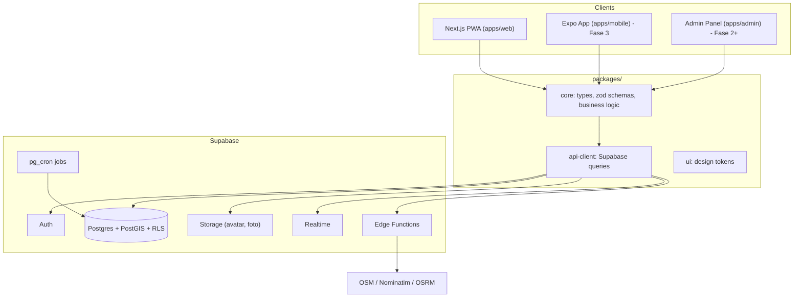
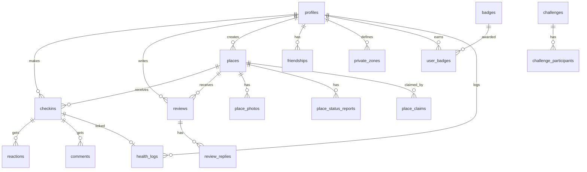
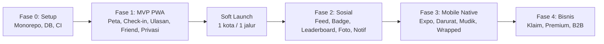

# 💩 Modoltracker: Project Blueprint

> **Dokumen ini adalah sumber kebenaran utama (single source of truth)** untuk pengembangan Modoltracker.
> Ditujukan untuk developer dan AI model yang akan mengimplementasikan proyek ini.
> Baca seluruh dokumen sebelum menulis kode, terutama bagian [Instruksi untuk Implementer](#16-instruksi-untuk-implementer-ai--developer).

| Info | Nilai |
|---|---|
| Nama Produk | **Modoltracker** |
| Domain | **modoltracker.web.id** |
| Tagline (sopan, untuk Store) | *"Temukan toilet terbaik, catat setiap perjalananmu."* |
| Tagline (sosmed/fun) | *"Jejak modolmu, panduan toilet semua orang."* |
| Bahasa UI utama | Bahasa Indonesia (siapkan i18n untuk English) |
| Target Platform | Web (PWA) → Android & iOS |
| Status dokumen | v1.0, hasil brainstorming |

---

## Daftar Isi
1. [Visi & Konsep](#1-visi--konsep)
2. [Target Pengguna & Persona](#2-target-pengguna--persona)
3. [Prinsip Produk](#3-prinsip-produk)
4. [Daftar Fitur per Fase](#4-daftar-fitur-per-fase)
5. [Detail Fitur](#5-detail-fitur)
6. [Tech Stack](#6-tech-stack)
7. [Arsitektur Sistem](#7-arsitektur-sistem)
8. [Struktur Folder (Monorepo)](#8-struktur-folder-monorepo)
9. [Skema Database](#9-skema-database)
10. [Keamanan & Privasi](#10-keamanan--privasi)
11. [Feature Flags](#11-feature-flags)
12. [Struktur Halaman / Routing](#12-struktur-halaman--routing)
13. [Desain & Branding](#13-desain--branding)
14. [Strategi Cold Start & Growth](#14-strategi-cold-start--growth)
15. [Monetisasi](#15-monetisasi-masa-depan)
16. [Instruksi untuk Implementer](#16-instruksi-untuk-implementer-ai--developer)
17. [Roadmap](#17-roadmap)
18. [Risiko & Mitigasi](#18-risiko--mitigasi)
19. [Glosarium](#19-glosarium)

---

## 1. Visi & Konsep

**Masalah:** Saat di perjalanan, orang sering kesulitan menemukan toilet yang bersih, ada airnya, dan nyaman. Tidak ada sumber informasi yang fokus pada kualitas toilet di Indonesia.

**Solusi:** Modoltracker menggabungkan dua sisi:

| Sisi | Deskripsi | Peran |
|---|---|---|
| 🗺️ **Utilitas** | Direktori toilet publik dengan ulasan komunitas (SPBU, minimarket, masjid, mall, rest area) | **Nilai utama.** Alasan orang terus kembali |
| 😂 **Fun / Sosial** | Tracker pribadi "aku pernah modol di sini", peta jejak, badge, berbagi dengan teman | **Mesin viral.** Alasan orang berbagi dan mengajak teman |

**Visi jangka panjang:** Menjadi "Google Maps-nya toilet" di Indonesia, sumber data kualitas toilet publik terbesar.

---

## 2. Target Pengguna & Persona

| Persona | Kebutuhan | Fitur Kunci |
|---|---|---|
| 🚗 **Andi, pengendara / pemudik** | Toilet bersih di jalan & rest area tol | Cari terdekat, Mode Darurat, Mode Mudik |
| 🛵 **Sari, ojol / kurir** | Toilet gratis & cepat sepanjang hari | Filter gratis, status real-time |
| 🎒 **Rizky, traveler / mahasiswa** | Seru-seruan dengan teman, koleksi badge | Friend, badge, leaderboard, Wrapped |
| 👨‍👩‍👧 **Bu Dewi, orang tua** | Toilet dengan ruang ganti popok, ramah anak | Filter fasilitas |
| ♿ **Pak Budi, pengguna kursi roda** | Toilet aksesibel | Filter disabilitas |
| 🏪 **Pemilik usaha** *(masa depan)* | Reputasi toilet usahanya | Klaim lokasi, balas ulasan |

---

## 3. Prinsip Produk

1. **Simpel dulu.** MVP harus bisa dipakai dalam < 10 detik untuk check-in.
2. **Lucu tapi bersih.** Humor ya, jorok tidak. Tidak ada foto kotoran; gunakan ikon kartun.
3. **Privasi by default.** Lokasi adalah data sensitif. Default visibility check-in = `friends`.
4. **Mobile-first.** Semua UI didesain untuk layar HP terlebih dahulu.
5. **Siap berkembang.** Struktur kode & database sudah menyiapkan tempat untuk fitur masa depan, tetapi diaktifkan via **feature flags**.
6. **Lokal Indonesia.** Jongkok/duduk, gayung/jet washer, tarif Rp2.000, mushola, mudik.

---

## 4. Daftar Fitur per Fase

Legenda status: 🟢 Dikerjakan di fase ini · 🟡 Disiapkan tempatnya (placeholder/flag OFF) · ⚪ Hanya konsep

### Fase 1: MVP (Web PWA)
| # | Fitur | Status |
|---|---|---|
| F1.1 | Auth (Google OAuth + Email magic link) | 🟢 |
| F1.2 | Profil user (username, avatar, bio) | 🟢 |
| F1.3 | Peta interaktif toilet (Leaflet + OSM) | 🟢 |
| F1.4 | Tambah lokasi toilet baru | 🟢 |
| F1.5 | Check-in "Modol di sini" (GPS) | 🟢 |
| F1.6 | Ulasan & rating multi-kategori | 🟢 |
| F1.7 | Cari toilet terdekat + filter | 🟢 |
| F1.8 | Detail toilet (info, fasilitas, ulasan) | 🟢 |
| F1.9 | Peta jejak pribadi ("My Modol Map") | 🟢 |
| F1.10 | Statistik pribadi dasar | 🟢 |
| F1.11 | Sistem friend (request, accept, block) | 🟢 |
| F1.12 | Lihat peta jejak teman | 🟢 |
| F1.13 | Pengaturan privasi per check-in | 🟢 |
| F1.14 | Zona privat (sembunyikan area rumah) | 🟢 |
| F1.15 | Report konten / lokasi | 🟢 |
| F1.16 | Seed data dari OpenStreetMap | 🟢 |
| F1.17 | PWA (installable, ikon, splash) | 🟢 |

### Fase 2: Sosial & Gamifikasi
| # | Fitur | Status |
|---|---|---|
| F2.1 | Feed aktivitas teman | 🟡 |
| F2.2 | Reaksi emoji (💩 😂 🫡 🤢) | 🟡 |
| F2.3 | Komentar pada check-in | 🟡 |
| F2.4 | Badge & achievement | 🟡 |
| F2.5 | Title lucu ("Raja SPBU") | 🟡 |
| F2.6 | Leaderboard teman (mingguan/bulanan) | 🟡 |
| F2.7 | Share card (gambar untuk IG/WA) | 🟡 |
| F2.8 | Invite link & QR code | 🟡 |
| F2.9 | Notifikasi (in-app + push) | 🟡 |
| F2.10 | Foto toilet (dengan moderasi) | 🟡 |
| F2.11 | Status real-time ("air mati", "antre") | 🟡 |
| F2.12 | Rekomendasi "teman kamu suka toilet ini" | 🟡 |

### Fase 3: Mobile Native & Utilitas Lanjut
| # | Fitur | Status |
|---|---|---|
| F3.1 | Aplikasi Android & iOS (Expo) | 🟡 |
| F3.2 | Mode Darurat 🚨 (1 tombol) | 🟡 |
| F3.3 | Mode Mudik / Road Trip (toilet sepanjang rute) | 🟡 |
| F3.4 | Offline mode (cache area) | 🟡 |
| F3.5 | Challenge antar teman | 🟡 |
| F3.6 | Modol Wrapped 🎁 (rekap tahunan) | 🟡 |
| F3.7 | Toilet of the Month | 🟡 |
| F3.8 | Health Log / Bristol Scale (privat) | 🟡 |

### Fase 4: Bisnis & Ekosistem
| # | Fitur | Status |
|---|---|---|
| F4.1 | Klaim lokasi oleh pemilik usaha | 🟡 |
| F4.2 | Balas ulasan oleh pemilik | 🟡 |
| F4.3 | Badge "Bersih Terverifikasi" (berbayar) | 🟡 |
| F4.4 | Premium (tanpa iklan, fitur ekstra) | 🟡 |
| F4.5 | Iklan lokal | ⚪ |
| F4.6 | Dashboard B2B / data insight | ⚪ |
| F4.7 | Public API | ⚪ |
| F4.8 | Kerja sama Pemda / Pertamina / Jasa Marga | ⚪ |
| F4.9 | Toilet rumah warga publik (dengan izin pemilik) | ⚪ |

---

## 5. Detail Fitur

### 5.1 Check-in "Modol di Sini" (F1.5)
- Tombol utama (FAB) di peta: **"💩 Modol di sini"**.
- Ambil GPS → tampilkan toilet terdekat dalam radius **100 m** → user pilih, atau buat lokasi baru.
- Opsi check-in **tanpa toilet publik** (mis. rumah sendiri/rumah warga) → `place_id = null`, hanya tercatat di tracker pribadi, **tidak pernah tampil di peta publik**.
- Field: visibility (`public` / `friends` / `private`), catatan singkat (opsional, maks 280 karakter).
- Setelah check-in → prompt opsional "Beri ulasan?".
- **Anti-spam:** maks 1 check-in per tempat per 30 menit, maks 20 check-in per hari.

### 5.2 Ulasan & Rating (F1.6)
Rating 1–5 per kategori:

| Kategori | Ikon | Wajib |
|---|---|---|
| Kebersihan | 🧼 | ✅ |
| Ketersediaan air | 💧 | ✅ |
| Privasi / kunci pintu | 🚪 | ❌ |
| Bau | 👃 | ❌ |
| Kelengkapan (tisu, sabun) | 🧻 | ❌ |

- `overall_rating` = rata-rata kategori yang diisi (dihitung di DB).
- Teks ulasan opsional (maks 1000 karakter).
- **Verifikasi lokasi:** ulasan dengan GPS dalam radius 150 m → badge "✅ Terverifikasi di lokasi". Ulasan tanpa verifikasi tetap boleh, tapi bobotnya lebih kecil.
- 1 user = 1 ulasan aktif per tempat (bisa di-update).

### 5.3 Info Tempat / Toilet (F1.4, F1.8)
- **Kategori tempat:** `gas_station`, `minimarket`, `mosque`, `mall`, `restaurant`, `cafe`, `rest_area`, `public_toilet`, `office`, `hospital`, `station`, `airport`, `campus`, `other`.
- **Fasilitas (boolean):** jongkok, duduk, jet washer, gayung, tisu, sabun, wastafel, ramah disabilitas, ruang ganti popok, bisa mandi, mushola/tempat wudhu terdekat, terpisah pria/wanita.
- **Tarif:** gratis / berbayar (nominal) / seikhlasnya.
- **Jam buka:** 24 jam atau rentang jam.
- Tempat baru yang dibuat user berstatus `unverified` sampai ada ≥ 3 check-in/ulasan dari user berbeda.

### 5.4 Cari Toilet Terdekat (F1.7)
- Query PostGIS `ST_DWithin` + urut berdasarkan jarak.
- Filter: kategori, rating minimal, gratis, buka sekarang, fasilitas.
- Tampilan: peta + list (toggle).
- Tombol "Navigasi" → deep link ke Google Maps / Waze.

### 5.5 Sistem Friend (F1.11, F1.12)
- Model **mutual** (perlu persetujuan dua pihak).
- Cara add: cari username, *(Fase 2)* invite link & QR.
- Status: `pending` → `accepted` / `declined`; `blocked` terpisah.
- Yang terlihat oleh teman: peta jejak (check-in `public` + `friends`), statistik, badge.
- Yang terlihat oleh non-teman: hanya profil dasar + statistik agregat (jumlah check-in, jumlah kota), **tanpa titik lokasi**.

### 5.6 Privasi (F1.13, F1.14)
- **Visibility per check-in**, default diatur di pengaturan (default sistem: `friends`).
- **Zona Privat:** user menandai titik (rumah/kantor) + radius (200–1000 m). Check-in di dalam zona otomatis `private`.
- **Delay posting** *(disiapkan untuk feed Fase 2)*: check-in baru tampil ke teman setelah `N` jam (default 2 jam, bisa diatur 0–24).
- Akun privat: hanya teman yang bisa melihat profil.

### 5.7 Statistik Pribadi (F1.10)
- Total check-in, jumlah tempat unik, jumlah kota/provinsi, kategori favorit, tempat paling sering, streak harian, check-in per bulan (grafik).

### 5.8 Gamifikasi (F2.4–F2.6) 🟡
Badge didefinisikan di tabel `badges` dengan `criteria` JSON agar bisa ditambah tanpa ubah kode.

Contoh badge:
| Kode | Nama | Kriteria |
|---|---|---|
| `first_drop` | Pertama Kali 💩 | 1 check-in |
| `spbu_explorer` | Penjelajah SPBU ⛽ | 10 SPBU berbeda |
| `city_hopper` | Modol Lintas Kota 🏙️ | 5 kota berbeda |
| `nusantara` | Modol Nusantara 🇮🇩 | 10 provinsi |
| `night_owl` | Kalong Toilet 🦉 | 5 check-in jam 00:00–04:00 |
| `reviewer` | Kritikus Toilet 📝 | 20 ulasan |
| `pioneer` | Pionir 🚩 | Menambahkan 5 tempat baru yang terverifikasi |
| `mudik_warrior` | Pejuang Mudik 🚗 | Check-in di 5 rest area dalam 1 hari |

Title (ditampilkan di profil): "Raja SPBU", "Sultan Toilet Mall", "Petualang Jongkok", "Santri Toilet Masjid".

### 5.9 Feed & Reaksi (F2.1–F2.3) 🟡
- Feed check-in dan badge dari teman, urut kronologis, mematuhi delay & visibility.
- Reaksi: 💩 😂 🫡 🤢 (1 reaksi per user per check-in).

### 5.10 Status Real-time (F2.11) 🟡
- Tipe: `no_water`, `long_queue`, `cleaning`, `closed`, `out_of_order`, `very_clean`.
- Kedaluwarsa otomatis (`expires_at`, default 3 jam). Bisa dikonfirmasi user lain ("masih begitu?").

### 5.11 Mode Darurat 🚨 (F3.2) 🟡
- Satu tombol besar → langsung pilih toilet terbaik dengan skor: `skor = rating × faktor_buka × (1 / jarak)` → buka navigasi.

### 5.12 Mode Mudik (F3.3) 🟡
- Input asal–tujuan → ambil polyline rute (OSRM/Mapbox Directions) → cari toilet dalam buffer 1 km dari rute (`ST_DWithin` terhadap `LINESTRING`) → prioritaskan rest area.

### 5.13 Modol Wrapped 🎁 (F3.6) 🟡
- Rekap tahunan: total, kota terbanyak, toilet favorit, jam favorit, "persona" (mis. "Si Pemburu SPBU"). Output berupa story card yang bisa dibagikan.

### 5.14 Health Log / Bristol Scale (F3.8) 🟡
- **Selalu privat, tidak pernah dibagikan.** Skala Bristol 1–7, catatan opsional, insight pola (mis. peringatan jika tidak BAB > 3 hari). Tambahkan disclaimer "bukan saran medis".

### 5.15 Klaim Bisnis (F4.1–F4.3) 🟡
- Pemilik mengajukan klaim + bukti → admin verifikasi → pemilik bisa balas ulasan, update info, beli badge "Bersih Terverifikasi".

---

## 6. Tech Stack

### 6.1 Ringkasan Keputusan
Strategi: **mulai dari Web PWA (validasi cepat), lalu mobile native dengan Expo** tanpa menulis ulang backend & logika bisnis. Seluruh kode memakai **TypeScript**.

| Lapisan | Teknologi | Alasan |
|---|---|---|
| Bahasa | **TypeScript** (strict) | Satu bahasa untuk web, mobile, dan shared logic |
| Monorepo | **Turborepo** + **pnpm workspaces** | Berbagi kode antara web & mobile |
| Web | **Next.js 15+ (App Router)** | SSR/SEO (halaman toilet bisa diindeks Google), PWA |
| Mobile *(Fase 3)* | **React Native + Expo (Expo Router)** | Android & iOS dari satu codebase |
| Styling Web | **Tailwind CSS** + **shadcn/ui** | Cepat, konsisten |
| Styling Mobile | **NativeWind** | Kelas Tailwind yang sama di mobile |
| Backend | **Supabase** | Postgres, Auth, Storage, Realtime, Edge Functions |
| Database | **PostgreSQL + PostGIS** | Query geospasial (terdekat, radius, rute) |
| Peta Web | **Leaflet + react-leaflet** + tile OSM (atau MapTiler) | Gratis; bisa diganti Mapbox nanti |
| Peta Mobile | **react-native-maps** (atau MapLibre) | Native performance |
| Clustering | **supercluster** | Banyak pin tetap ringan |
| Data fetching | **TanStack Query** | Caching, offline-friendly |
| State lokal | **Zustand** | Ringan |
| Validasi | **Zod** | Skema dipakai bersama di client & server |
| Form | **React Hook Form** | |
| i18n | **next-intl** (web) / **i18next** (mobile) | ID default, EN disiapkan |
| PWA | **Serwist** (`@serwist/next`) | Service worker, offline cache |
| Push notif *(Fase 2)* | Web Push (VAPID) → **Expo Notifications** | |
| Share card *(Fase 2)* | **@vercel/og** (Satori) | Generate gambar dinamis |
| Geocoding | **Nominatim** (OSM) | Reverse geocoding kota/provinsi |
| Routing *(Fase 3)* | **OSRM** / Mapbox Directions | Mode Mudik |
| Testing | **Vitest**, **Playwright**, pgTAP (opsional) | |
| Lint/format | ESLint + Prettier | |
| Error tracking | **Sentry** | |
| Analytics | **PostHog** | Event & feature flag (opsional) |
| Hosting Web | **Vercel** | |
| CI/CD | **GitHub Actions** | Lint, typecheck, test, migrasi |

### 6.2 Kenapa Tidak Pilihan Lain?
- **Flutter:** bagus untuk mobile, tetapi SEO web lemah. Halaman toilet perlu muncul di Google.
- **Firebase:** query geospasial terbatas. PostGIS jauh lebih kuat untuk fitur "terdekat" dan "sepanjang rute".
- **Backend custom (NestJS/Laravel):** belum perlu. Supabase cukup sampai skala besar; bisa ditambah service terpisah nanti di `services/`.

---

## 7. Arsitektur Sistem



**Aturan arsitektur:**
- Logika bisnis (perhitungan skor, validasi, aturan badge) berada di `packages/core`, **bukan** di komponen UI.
- Semua akses data lewat `packages/api-client`, sehingga web & mobile memakai fungsi yang sama.
- Keamanan data ditegakkan di **database (RLS)**, bukan hanya di frontend.
- Operasi berat/sensitif (cek badge, moderasi foto, seed OSM, Wrapped) lewat **Edge Functions** atau **pg_cron**.

---

## 8. Struktur Folder (Monorepo)

> Folder bertanda 🟡 dibuat sekarang **sebagai placeholder** (berisi `README.md` yang menjelaskan tujuannya) agar struktur siap saat fitur dikembangkan.

```
modoltracker/
├── apps/
│   ├── web/                          # Next.js PWA (Fase 1) 🟢
│   │   ├── app/
│   │   │   ├── (auth)/               # login, callback
│   │   │   ├── (main)/
│   │   │   │   ├── map/              # peta utama
│   │   │   │   ├── place/[id]/       # detail toilet
│   │   │   │   ├── checkin/          # alur check-in
│   │   │   │   ├── me/               # profil & peta jejak sendiri
│   │   │   │   ├── u/[username]/     # profil user lain
│   │   │   │   ├── friends/          # daftar & request teman
│   │   │   │   ├── settings/         # privasi, zona privat
│   │   │   │   ├── feed/             # 🟡 Fase 2
│   │   │   │   ├── leaderboard/      # 🟡 Fase 2
│   │   │   │   ├── badges/           # 🟡 Fase 2
│   │   │   │   ├── notifications/    # 🟡 Fase 2
│   │   │   │   ├── emergency/        # 🟡 Fase 3
│   │   │   │   ├── trip/             # 🟡 Fase 3 (Mode Mudik)
│   │   │   │   ├── challenges/       # 🟡 Fase 3
│   │   │   │   ├── wrapped/[year]/   # 🟡 Fase 3
│   │   │   │   ├── health/           # 🟡 Fase 3
│   │   │   │   └── business/         # 🟡 Fase 4
│   │   │   ├── toilet/[city]/[slug]/ # halaman SEO publik
│   │   │   └── api/                  # route handlers (OG image, webhooks)
│   │   ├── components/
│   │   │   ├── map/
│   │   │   ├── place/
│   │   │   ├── checkin/
│   │   │   ├── review/
│   │   │   ├── social/
│   │   │   └── common/
│   │   ├── features/                 # modul per fitur (lihat 8.1)
│   │   ├── lib/
│   │   ├── messages/                 # i18n: id.json, en.json
│   │   └── public/                   # ikon PWA, manifest
│   ├── mobile/                       # 🟡 Expo app (Fase 3)
│   └── admin/                        # 🟡 Panel admin & moderasi (Fase 2+)
│
├── packages/
│   ├── core/                         # 🟢 shared logic
│   │   ├── src/
│   │   │   ├── types/                # tipe domain
│   │   │   ├── schemas/              # Zod schemas
│   │   │   ├── constants/            # kategori, fasilitas, emoji reaksi
│   │   │   ├── rules/                # rating calc, anti-spam, privasi
│   │   │   ├── flags/                # definisi feature flags
│   │   │   ├── gamification/         # 🟡 evaluator badge
│   │   │   ├── emergency/            # 🟡 skor mode darurat
│   │   │   └── trip/                 # 🟡 logika rute
│   ├── api-client/                   # 🟢 wrapper Supabase + TanStack Query hooks
│   ├── ui/                           # 🟢 design tokens (warna, font, spacing)
│   ├── db-types/                     # 🟢 tipe hasil `supabase gen types`
│   └── config/                       # 🟢 eslint, tsconfig, tailwind preset
│
├── supabase/
│   ├── migrations/                   # SQL migration berurutan
│   ├── functions/                    # Edge Functions
│   │   ├── seed-osm/                 # 🟢 import data OSM
│   │   ├── reverse-geocode/          # 🟢 isi kota/provinsi
│   │   ├── evaluate-badges/          # 🟡
│   │   ├── moderate-photo/           # 🟡
│   │   ├── send-push/                # 🟡
│   │   ├── generate-wrapped/         # 🟡
│   │   └── trip-route/               # 🟡
│   ├── seed.sql                      # data dev (kategori, badge, contoh tempat)
│   └── config.toml
│
├── services/                         # 🟡 service terpisah bila dibutuhkan (mis. analytics worker)
├── PROJECT_BLUEPRINT.md              # dokumen ini (tetap di root)
├── docs/
│   ├── DECISIONS.md                  # log keputusan arsitektur (ADR)
│   └── API.md                        # daftar RPC & endpoint
├── .github/workflows/
├── turbo.json
├── pnpm-workspace.yaml
└── package.json
```

### 8.1 Pola Modul Fitur
Setiap fitur di `apps/web/features/<nama-fitur>/`:
```
features/checkin/
├── components/       # UI khusus fitur
├── hooks/            # hooks khusus fitur
├── actions.ts        # server actions (jika perlu)
├── index.ts          # public export
└── README.md         # deskripsi, status, flag terkait
```
Fitur 🟡 cukup berisi `README.md` + `index.ts` kosong + komponen "Segera Hadir" yang dirender jika flag OFF.

---

## 9. Skema Database

> Semua tabel dibuat lewat migration di `supabase/migrations/`. Tabel untuk fitur masa depan (🟡) **tetap dibuat sejak awal** agar skema stabil; aksesnya dikunci via RLS & feature flag.
> Konvensi: `snake_case`, PK `uuid` (`gen_random_uuid()`), `created_at`/`updated_at` `timestamptz`, soft delete dengan `deleted_at` bila perlu.

### 9.1 ERD



### 9.2 Enum

```sql
create extension if not exists postgis;
create extension if not exists pg_trgm;   -- pencarian nama

create type place_category as enum (
  'gas_station','minimarket','mosque','mall','restaurant','cafe','rest_area',
  'public_toilet','office','hospital','station','airport','campus','other'
);
create type place_status   as enum ('unverified','verified','closed','removed');
create type visibility     as enum ('public','friends','private');
create type friend_status  as enum ('pending','accepted','declined');
create type fee_type       as enum ('free','paid','donation','unknown');
create type report_target  as enum ('place','review','checkin','photo','profile','comment');
create type report_status  as enum ('open','reviewing','resolved','rejected');
create type live_status    as enum ('no_water','long_queue','cleaning','closed','out_of_order','very_clean');
create type user_role      as enum ('user','moderator','admin');
create type claim_status   as enum ('pending','approved','rejected');
```

### 9.3 Tabel Fase 1 🟢

```sql
-- PROFIL USER (1:1 dengan auth.users)
create table profiles (
  id                    uuid primary key references auth.users(id) on delete cascade,
  username              text unique not null check (username ~ '^[a-z0-9_]{3,20}$'),
  display_name          text,
  avatar_url            text,
  bio                   text check (char_length(bio) <= 160),
  role                  user_role not null default 'user',
  is_private            boolean not null default false,
  default_visibility    visibility not null default 'friends',
  feed_delay_hours      int not null default 2 check (feed_delay_hours between 0 and 24),
  locale                text not null default 'id',
  active_title          text,                         -- 🟡 Fase 2
  is_premium            boolean not null default false, -- 🟡 Fase 4
  created_at            timestamptz not null default now(),
  updated_at            timestamptz not null default now()
);

-- TEMPAT / TOILET
create table places (
  id               uuid primary key default gen_random_uuid(),
  name             text not null,
  slug             text unique,
  category         place_category not null,
  location         geography(point, 4326) not null,
  address          text,
  city             text,
  province         text,
  status           place_status not null default 'unverified',
  source           text not null default 'user',     -- 'user' | 'osm'
  osm_id           text unique,
  -- fasilitas
  has_squat        boolean, has_sitting   boolean,
  has_jet_washer   boolean, has_bucket    boolean,  -- gayung
  has_tissue       boolean, has_soap      boolean,
  has_sink         boolean, is_accessible boolean,
  has_baby_change  boolean, has_shower    boolean,
  has_prayer_room  boolean, gender_separated boolean,
  -- operasional
  fee_type         fee_type not null default 'unknown',
  fee_amount       int,                                -- rupiah
  is_24h           boolean,
  opening_hours    jsonb,                              -- {"mon":[["06:00","22:00"]], ...}
  -- agregat (diupdate trigger)
  avg_rating       numeric(2,1),
  avg_cleanliness  numeric(2,1),
  avg_water        numeric(2,1),
  review_count     int not null default 0,
  checkin_count    int not null default 0,
  -- bisnis 🟡
  claimed_by       uuid references profiles(id),
  is_verified_clean boolean not null default false,
  created_by       uuid references profiles(id),
  created_at       timestamptz not null default now(),
  updated_at       timestamptz not null default now()
);
create index places_location_gix on places using gist (location);
create index places_name_trgm on places using gin (name gin_trgm_ops);

-- CHECK-IN
create table checkins (
  id            uuid primary key default gen_random_uuid(),
  user_id       uuid not null references profiles(id) on delete cascade,
  place_id      uuid references places(id) on delete set null,  -- null = lokasi pribadi
  location      geography(point, 4326) not null,
  city          text,
  province      text,
  visibility    visibility not null default 'friends',
  note          text check (char_length(note) <= 280),
  in_private_zone boolean not null default false,
  visible_at    timestamptz not null default now(),  -- untuk delay posting
  created_at    timestamptz not null default now()
);
create index checkins_user_idx on checkins (user_id, created_at desc);
create index checkins_place_idx on checkins (place_id);
create index checkins_location_gix on checkins using gist (location);

-- ULASAN
create table reviews (
  id                uuid primary key default gen_random_uuid(),
  user_id           uuid not null references profiles(id) on delete cascade,
  place_id          uuid not null references places(id) on delete cascade,
  checkin_id        uuid references checkins(id) on delete set null,
  rating_cleanliness smallint not null check (rating_cleanliness between 1 and 5),
  rating_water       smallint not null check (rating_water between 1 and 5),
  rating_privacy     smallint check (rating_privacy between 1 and 5),
  rating_smell       smallint check (rating_smell between 1 and 5),
  rating_supplies    smallint check (rating_supplies between 1 and 5),
  overall_rating     numeric(2,1) not null,   -- dihitung trigger
  body              text check (char_length(body) <= 1000),
  is_location_verified boolean not null default false,
  created_at        timestamptz not null default now(),
  updated_at        timestamptz not null default now(),
  unique (user_id, place_id)
);

-- PERTEMANAN (simpan 1 baris per pasangan, requester -> addressee)
create table friendships (
  id            uuid primary key default gen_random_uuid(),
  requester_id  uuid not null references profiles(id) on delete cascade,
  addressee_id  uuid not null references profiles(id) on delete cascade,
  status        friend_status not null default 'pending',
  created_at    timestamptz not null default now(),
  responded_at  timestamptz,
  check (requester_id <> addressee_id)
);
create unique index friendships_pair_uq on friendships
  (least(requester_id, addressee_id), greatest(requester_id, addressee_id));

-- BLOKIR
create table blocks (
  blocker_id  uuid not null references profiles(id) on delete cascade,
  blocked_id  uuid not null references profiles(id) on delete cascade,
  created_at  timestamptz not null default now(),
  primary key (blocker_id, blocked_id)
);

-- ZONA PRIVAT
create table private_zones (
  id          uuid primary key default gen_random_uuid(),
  user_id     uuid not null references profiles(id) on delete cascade,
  label       text not null default 'Rumah',
  center      geography(point, 4326) not null,
  radius_m    int not null default 500 check (radius_m between 200 and 1000),
  created_at  timestamptz not null default now()
);

-- LAPORAN / REPORT
create table reports (
  id           uuid primary key default gen_random_uuid(),
  reporter_id  uuid not null references profiles(id) on delete cascade,
  target_type  report_target not null,
  target_id    uuid not null,
  reason       text not null,
  details      text,
  status       report_status not null default 'open',
  resolved_by  uuid references profiles(id),
  created_at   timestamptz not null default now()
);

-- FEATURE FLAGS (lihat bagian 11)
create table feature_flags (
  key          text primary key,
  enabled      boolean not null default false,
  rollout_pct  int not null default 0 check (rollout_pct between 0 and 100),
  allowed_roles user_role[] default '{admin}',
  description  text,
  updated_at   timestamptz not null default now()
);
```

### 9.4 Tabel Fase 2+ 🟡 (dibuat sekarang, belum dipakai)

```sql
-- REAKSI (F2.2)
create table reactions (
  checkin_id  uuid not null references checkins(id) on delete cascade,
  user_id     uuid not null references profiles(id) on delete cascade,
  emoji       text not null check (emoji in ('💩','😂','🫡','🤢')),
  created_at  timestamptz not null default now(),
  primary key (checkin_id, user_id)
);

-- KOMENTAR (F2.3)
create table comments (
  id          uuid primary key default gen_random_uuid(),
  checkin_id  uuid not null references checkins(id) on delete cascade,
  user_id     uuid not null references profiles(id) on delete cascade,
  body        text not null check (char_length(body) <= 300),
  created_at  timestamptz not null default now(),
  deleted_at  timestamptz
);

-- BADGE (F2.4)
create table badges (
  code         text primary key,
  name         text not null,
  description  text,
  icon         text,
  tier         smallint default 1,
  criteria     jsonb not null,        -- {"type":"distinct_places","category":"gas_station","count":10}
  is_active    boolean not null default true
);
create table user_badges (
  user_id     uuid not null references profiles(id) on delete cascade,
  badge_code  text not null references badges(code),
  earned_at   timestamptz not null default now(),
  primary key (user_id, badge_code)
);

-- FOTO TEMPAT (F2.10)
create table place_photos (
  id           uuid primary key default gen_random_uuid(),
  place_id     uuid not null references places(id) on delete cascade,
  user_id      uuid not null references profiles(id) on delete cascade,
  storage_path text not null,
  moderation   text not null default 'pending',  -- pending | approved | rejected
  created_at   timestamptz not null default now()
);

-- STATUS REAL-TIME (F2.11)
create table place_status_reports (
  id          uuid primary key default gen_random_uuid(),
  place_id    uuid not null references places(id) on delete cascade,
  user_id     uuid not null references profiles(id) on delete cascade,
  status      live_status not null,
  confirmations int not null default 0,
  expires_at  timestamptz not null default now() + interval '3 hours',
  created_at  timestamptz not null default now()
);

-- NOTIFIKASI (F2.9)
create table notifications (
  id          uuid primary key default gen_random_uuid(),
  user_id     uuid not null references profiles(id) on delete cascade,
  type        text not null,           -- friend_request | reaction | badge | comment | ...
  payload     jsonb not null default '{}',
  read_at     timestamptz,
  created_at  timestamptz not null default now()
);
create table push_tokens (
  id          uuid primary key default gen_random_uuid(),
  user_id     uuid not null references profiles(id) on delete cascade,
  platform    text not null,           -- web | ios | android
  token       text not null unique,
  created_at  timestamptz not null default now()
);

-- INVITE LINK (F2.8)
create table invites (
  code        text primary key,
  inviter_id  uuid not null references profiles(id) on delete cascade,
  uses        int not null default 0,
  max_uses    int,
  expires_at  timestamptz,
  created_at  timestamptz not null default now()
);

-- CHALLENGE (F3.5)
create table challenges (
  id          uuid primary key default gen_random_uuid(),
  creator_id  uuid not null references profiles(id) on delete cascade,
  title       text not null,
  rule        jsonb not null,          -- {"type":"distinct_places","category":"gas_station"}
  starts_at   timestamptz not null,
  ends_at     timestamptz not null,
  created_at  timestamptz not null default now()
);
create table challenge_participants (
  challenge_id uuid not null references challenges(id) on delete cascade,
  user_id      uuid not null references profiles(id) on delete cascade,
  score        int not null default 0,
  joined_at    timestamptz not null default now(),
  primary key (challenge_id, user_id)
);

-- MODE MUDIK (F3.3)
create table trips (
  id          uuid primary key default gen_random_uuid(),
  user_id     uuid not null references profiles(id) on delete cascade,
  origin      geography(point, 4326) not null,
  destination geography(point, 4326) not null,
  route       geography(linestring, 4326),
  created_at  timestamptz not null default now()
);

-- WRAPPED (F3.6)
create table wrapped_reports (
  user_id     uuid not null references profiles(id) on delete cascade,
  year        int not null,
  data        jsonb not null,
  generated_at timestamptz not null default now(),
  primary key (user_id, year)
);

-- HEALTH LOG (F3.8) — SELALU PRIVAT
create table health_logs (
  id          uuid primary key default gen_random_uuid(),
  user_id     uuid not null references profiles(id) on delete cascade,
  checkin_id  uuid references checkins(id) on delete set null,
  bristol     smallint check (bristol between 1 and 7),
  note        text,
  logged_at   timestamptz not null default now()
);

-- BISNIS (F4.1–F4.3)
create table place_claims (
  id          uuid primary key default gen_random_uuid(),
  place_id    uuid not null references places(id) on delete cascade,
  user_id     uuid not null references profiles(id) on delete cascade,
  business_name text not null,
  evidence_url text,
  status      claim_status not null default 'pending',
  reviewed_by uuid references profiles(id),
  created_at  timestamptz not null default now()
);
create table review_replies (
  id          uuid primary key default gen_random_uuid(),
  review_id   uuid not null unique references reviews(id) on delete cascade,
  user_id     uuid not null references profiles(id) on delete cascade,
  body        text not null check (char_length(body) <= 1000),
  created_at  timestamptz not null default now()
);
create table subscriptions (
  id          uuid primary key default gen_random_uuid(),
  user_id     uuid references profiles(id) on delete cascade,
  place_id    uuid references places(id) on delete cascade,
  plan        text not null,           -- premium_user | verified_clean
  status      text not null,
  provider    text,                    -- midtrans | xendit | revenuecat
  current_period_end timestamptz,
  created_at  timestamptz not null default now()
);
```

### 9.5 Fungsi & Trigger Penting

| Nama | Jenis | Fungsi |
|---|---|---|
| `handle_new_user()` | trigger `auth.users` | Buat baris `profiles` otomatis |
| `are_friends(a, b)` | function `stable` | `true` jika status `accepted` |
| `is_blocked(a, b)` | function | Cek blokir dua arah |
| `can_view_checkin(viewer, checkin)` | function | Gabungan visibility + friend + block + `visible_at` |
| `nearby_places(lat, lng, radius_m, filters jsonb)` | RPC | Cari tempat terdekat, urut jarak |
| `places_in_bbox(min_lng, min_lat, max_lng, max_lat, filters)` | RPC | Untuk viewport peta |
| `apply_checkin_rules()` | trigger `before insert` checkins | Rate limit, cek zona privat → set `private`, set `visible_at = now() + feed_delay` |
| `calc_review_overall()` | trigger `before insert/update` reviews | Hitung `overall_rating` |
| `refresh_place_aggregates()` | trigger `after` reviews/checkins | Update `avg_*`, `review_count`, `checkin_count`, auto-verify tempat |
| `user_stats(user_id)` | RPC | Statistik pribadi (menghormati privasi viewer) |
| `expire_status_reports` | pg_cron 🟡 | Bersihkan status kedaluwarsa |
| `evaluate_badges(user_id)` | function 🟡 | Dipanggil setelah check-in/ulasan |

---

## 10. Keamanan & Privasi

### 10.1 Row Level Security (wajib aktif di SEMUA tabel)

| Tabel | SELECT | INSERT/UPDATE/DELETE |
|---|---|---|
| `profiles` | Semua (kolom dasar); kolom sensitif hanya pemilik | Hanya pemilik |
| `places` | Semua, kecuali `status = 'removed'` | Insert: user login; update: pembuat (24 jam pertama), moderator, pemilik klaim |
| `checkins` | `can_view_checkin(auth.uid(), id)` | Hanya pemilik |
| `reviews` | Semua | Hanya pemilik |
| `friendships` | Hanya pihak terkait | Insert: requester; update: addressee (accept/decline); delete: kedua pihak |
| `private_zones` | **Hanya pemilik** | Hanya pemilik |
| `health_logs` | **Hanya pemilik** | Hanya pemilik |
| `reports` | Pelapor & moderator | Insert: user login |
| `feature_flags` | Semua (read) | Admin |
| Tabel 🟡 lain | Ikuti pola di atas; tambah syarat `is_feature_enabled('<key>')` | |

### 10.2 Aturan Privasi Lokasi
1. Check-in dengan `place_id = null` (rumah/lokasi pribadi) **tidak pernah** muncul di peta publik, hanya di peta jejak pemilik & teman (sesuai visibility).
2. Non-teman **tidak pernah** menerima koordinat check-in, hanya agregat (kota/jumlah).
3. Check-in dalam zona privat → otomatis `private`, koordinat tidak dikirim ke siapa pun selain pemilik.
4. `visible_at` menunda kemunculan check-in di peta teman/feed (anti real-time tracking).
5. Koordinat di response untuk teman dibulatkan ke **~100 m** jika `place_id = null`.
6. Fitur hapus akun & ekspor data (sesuai **UU PDP No. 27/2022**).

### 10.3 Keamanan Lain
- Rate limiting di trigger DB + Edge Functions.
- Validasi semua input dengan Zod di client **dan** constraint di DB.
- Upload foto: batasi tipe (jpg/png/webp), ukuran (≤ 5 MB), strip EXIF (GPS!), moderasi otomatis sebelum tampil.
- Jangan pernah expose `service_role` key ke client.

---

## 11. Feature Flags

Fitur 🟡 dikunci dengan flag. Definisi di `packages/core/src/flags/index.ts` dan nilai runtime di tabel `feature_flags`.

```ts
// packages/core/src/flags/index.ts
export const FEATURE_FLAGS = {
  // Fase 2
  feed:            { phase: 2, default: false, desc: 'Feed aktivitas teman' },
  reactions:       { phase: 2, default: false, desc: 'Reaksi emoji pada check-in' },
  comments:        { phase: 2, default: false, desc: 'Komentar pada check-in' },
  badges:          { phase: 2, default: false, desc: 'Badge & achievement' },
  leaderboard:     { phase: 2, default: false, desc: 'Leaderboard teman' },
  share_card:      { phase: 2, default: false, desc: 'Gambar share ke sosmed' },
  invites:         { phase: 2, default: false, desc: 'Invite link & QR' },
  notifications:   { phase: 2, default: false, desc: 'Notifikasi in-app & push' },
  photos:          { phase: 2, default: false, desc: 'Upload foto toilet' },
  live_status:     { phase: 2, default: false, desc: 'Status real-time toilet' },
  // Fase 3
  emergency_mode:  { phase: 3, default: false, desc: 'Tombol darurat' },
  trip_mode:       { phase: 3, default: false, desc: 'Mode Mudik / Road Trip' },
  offline_mode:    { phase: 3, default: false, desc: 'Cache area offline' },
  challenges:      { phase: 3, default: false, desc: 'Challenge antar teman' },
  wrapped:         { phase: 3, default: false, desc: 'Modol Wrapped tahunan' },
  toilet_of_month: { phase: 3, default: false, desc: 'Toilet of the Month' },
  health_log:      { phase: 3, default: false, desc: 'Bristol scale log (privat)' },
  // Fase 4
  business_claims: { phase: 4, default: false, desc: 'Klaim lokasi bisnis' },
  review_replies:  { phase: 4, default: false, desc: 'Balasan pemilik' },
  premium:         { phase: 4, default: false, desc: 'Langganan premium' },
  ads:             { phase: 4, default: false, desc: 'Iklan lokal' },
} as const;

export type FeatureKey = keyof typeof FEATURE_FLAGS;
```

**Pemakaian:**
- Hook `useFeature('feed')` → `boolean`.
- Komponen `<FeatureGate flag="feed" fallback={<ComingSoon />}>…</FeatureGate>`.
- SQL: `is_feature_enabled('feed')` di RLS policy tabel terkait.
- Menu navigasi untuk fitur OFF disembunyikan, atau tampil dengan label "Segera Hadir" (dikonfigurasi).

---

## 12. Struktur Halaman / Routing

| Route | Halaman | Fase | Auth |
|---|---|---|---|
| `/` | Landing page (pitch, CTA install) | 1 | ❌ |
| `/login` | Login Google / magic link | 1 | ❌ |
| `/onboarding` | Pilih username, izin lokasi, privasi default | 1 | ✅ |
| `/map` | Peta utama + FAB check-in + filter | 1 | ❌ (lihat), ✅ (aksi) |
| `/place/[id]` | Detail toilet + ulasan | 1 | ❌ |
| `/place/new` | Tambah tempat | 1 | ✅ |
| `/checkin` | Alur check-in | 1 | ✅ |
| `/me` | Profil sendiri + peta jejak + statistik | 1 | ✅ |
| `/u/[username]` | Profil user lain | 1 | ❌ (terbatas) |
| `/friends` | Teman, request masuk/keluar, cari | 1 | ✅ |
| `/settings` | Akun, privasi, zona privat, bahasa, hapus akun | 1 | ✅ |
| `/toilet/[city]/[slug]` | Halaman SEO publik | 1 | ❌ |
| `/feed` | Feed teman | 2 🟡 | ✅ |
| `/leaderboard` | Ranking teman | 2 🟡 | ✅ |
| `/badges` | Koleksi badge | 2 🟡 | ✅ |
| `/notifications` | Notifikasi | 2 🟡 | ✅ |
| `/invite/[code]` | Terima undangan | 2 🟡 | ❌ |
| `/emergency` | Mode darurat | 3 🟡 | ❌ |
| `/trip` | Mode Mudik | 3 🟡 | ✅ |
| `/challenges` | Challenge | 3 🟡 | ✅ |
| `/wrapped/[year]` | Modol Wrapped | 3 🟡 | ✅ |
| `/health` | Health log | 3 🟡 | ✅ |
| `/business` | Dashboard pemilik usaha | 4 🟡 | ✅ |
| `/admin/*` | Moderasi (di `apps/admin`) | 2+ 🟡 | ✅ admin |

**Navigasi bawah (mobile):** 🗺️ Peta · 👥 Teman · 💩 (FAB check-in) · 🏆 Badge/Feed *(Fase 2)* · 👤 Profil

---

## 13. Desain & Branding

> **Seluruh panduan desain ada di [DESIGN_SYSTEM.md](./DESIGN_SYSTEM.md)** (token warna, tipografi, ikon, maskot, komponen, alur UX, motion, copywriting, aksesibilitas, checklist anti-AI-slop).

Ringkasan:
- **Gaya:** playful & cerah ala Duolingo (tombol 3D "empuk", border tebal, maskot), **lucu tapi tidak jorok**.
- **Maskot:** Si Modi, karakter 💩 kartun imut.
- **Font:** Baloo 2 (heading) + Nunito (body).
- **Ikon:** Phosphor Icons + Microsoft Fluent Emoji 3D.
- **Warna utama:** `sunny` #FFC800 (CTA), `choco` #8A5A3B (brand), `splash` #1CB0F6 (air/info), `fresh` #4CC764 (sukses), `cherry` #FF4B4B (darurat).

---

## 14. Strategi Cold Start & Growth

1. **Seed data OSM:** import `amenity=toilets`, `amenity=fuel`, `shop=convenience`, `amenity=place_of_worship (religion=muslim)`, `highway=services` (rest area) via Overpass API → tabel `places` dengan `source='osm'`.
2. **Fokus geografis:** luncurkan dulu di 1 kota (mis. Jabodetabek) atau 1 jalur (Tol Trans-Jawa).
3. **Momentum Lebaran:** kampanye Mode Mudik menjelang mudik.
4. **Konten TikTok/IG:** review toilet SPBU secara lucu, "Modol Wrapped" di akhir tahun.
5. **Invite teman:** badge khusus untuk yang mengundang 3 teman.
6. **SEO:** halaman `/toilet/[city]/[slug]` untuk pencarian seperti "toilet SPBU Cikampek".

---

## 15. Monetisasi (Masa Depan)

| Model | Fase | Catatan |
|---|---|---|
| Premium user (tanpa iklan, tema, statistik lanjutan, Wrapped premium) | 4 | Via Midtrans/Xendit (web), RevenueCat (mobile) |
| Badge "Bersih Terverifikasi" untuk usaha | 4 | Langganan bulanan |
| Iklan lokal (kafe/minimarket terdekat) | 4 | Non-intrusif |
| Data insight B2B (Pertamina, Jasa Marga, Pemda) | 4+ | Data agregat & anonim saja |

---

## 16. Instruksi untuk Implementer (AI / Developer)

### 16.1 Aturan Umum
1. **Ikuti dokumen ini.** Jika ada keputusan yang menyimpang, catat di `docs/DECISIONS.md` (format ADR: konteks, keputusan, konsekuensi).
2. **Kerjakan fase demi fase.** Jangan mengimplementasikan fitur 🟡 kecuali diminta; cukup buat placeholder (folder + README + flag + tabel).
3. **TypeScript strict**, tanpa `any` kecuali benar-benar terpaksa (beri komentar alasannya).
4. **Keamanan di DB.** Setiap tabel baru wajib RLS + policy.
5. **Migration-first.** Perubahan skema hanya lewat file migration baru; jangan mengubah migration lama yang sudah di-apply.
6. **Generate types** setelah migration: `supabase gen types typescript` → `packages/db-types`.
7. **i18n:** jangan hardcode teks UI; gunakan file `messages/id.json`.
8. **Mobile-first & aksesibel:** target sentuh ≥ 44px, kontras cukup, label ARIA.
9. **Commit konvensional:** `feat:`, `fix:`, `chore:`, `docs:`, dll.
10. **Tulis test** untuk logika di `packages/core` (rules, perhitungan rating, privasi).

### 16.2 Urutan Pengerjaan Fase 1 (disarankan)
1. Setup monorepo (Turborepo + pnpm), `packages/config`, `apps/web` Next.js, Tailwind, shadcn/ui.
2. Buat **semua folder placeholder** sesuai bagian 8 (dengan README).
3. Setup Supabase lokal (`supabase init`), migration: extensions, enum, **semua tabel (Fase 1 + 🟡)**, fungsi, trigger, RLS.
4. `packages/core`: types, Zod schemas, constants, feature flags.
5. `packages/api-client`: client Supabase + hooks TanStack Query.
6. Auth + onboarding (username) + trigger `handle_new_user`.
7. Peta (Leaflet) + RPC `places_in_bbox` + clustering + filter.
8. Detail tempat + tambah tempat.
9. Check-in + aturan (rate limit, zona privat, visibility).
10. Ulasan + agregat rating.
11. Profil, peta jejak, statistik.
12. Sistem friend + block + `can_view_checkin`.
13. Settings privasi + zona privat + hapus akun.
14. Report konten.
15. Edge Function `seed-osm` + `reverse-geocode`.
16. PWA (manifest, service worker, ikon).
17. Halaman SEO publik + landing page.
18. Test, Sentry, deploy ke Vercel + Supabase cloud.

### 16.3 Definition of Done (per fitur)
- [ ] Berfungsi di layar mobile (≥ 360px) dan desktop
- [ ] RLS diuji (user lain tidak bisa mengakses data yang tidak berhak)
- [ ] Loading, empty, dan error state tersedia
- [ ] Teks via i18n
- [ ] Lolos lint + typecheck + test
- [ ] README fitur diperbarui (status 🟢)

### 16.4 Environment Variables
```
NEXT_PUBLIC_SUPABASE_URL=
NEXT_PUBLIC_SUPABASE_ANON_KEY=
SUPABASE_SERVICE_ROLE_KEY=          # server only
NEXT_PUBLIC_MAP_TILE_URL=           # default OSM / MapTiler
NEXT_PUBLIC_MAPTILER_KEY=           # opsional
NEXT_PUBLIC_SITE_URL=https://modoltracker.web.id
SENTRY_DSN=
NEXT_PUBLIC_POSTHOG_KEY=            # opsional
# 🟡 Fase 2+
VAPID_PUBLIC_KEY=
VAPID_PRIVATE_KEY=
OSRM_URL=
MIDTRANS_SERVER_KEY=
```

---

## 17. Roadmap



| Fase | Estimasi* | Target / KPI |
|---|---|---|
| 0: Setup | 1 minggu | Repo, DB, CI jalan |
| 1: MVP | 4–6 minggu | 100 user aktif, 500 ulasan di kota pilot |
| 2: Sosial | 4 minggu | Rasio invite > 20%, retensi minggu ke-4 > 25% |
| 3: Mobile | 6–8 minggu | Rilis Play Store & App Store |
| 4: Bisnis | berkelanjutan | 10 mitra usaha pertama |

\* Estimasi untuk 1 developer full-time; sesuaikan.

---

## 18. Risiko & Mitigasi

| Risiko | Dampak | Mitigasi |
|---|---|---|
| Peta kosong (cold start) | Tinggi | Seed OSM, fokus 1 kota, gamifikasi "Pionir" |
| Pelacakan lokasi / stalking | Tinggi | Visibility, zona privat, delay posting, pembulatan koordinat |
| Foto tidak pantas | Tinggi | Moderasi AI + manual, strip EXIF, report |
| Ulasan palsu / spam | Sedang | Verifikasi GPS, rate limit, bobot ulasan |
| Penolakan App Store/Play Store | Sedang | Branding "lucu tapi bersih", tagline sopan, tanpa foto kotoran |
| Keberatan brand (ulasan buruk SPBU dll.) | Sedang | Kebijakan konten jelas, hak jawab via klaim bisnis |
| Biaya peta/hosting membengkak | Sedang | Leaflet + OSM gratis, cache tile, Supabase free tier di awal |
| Kepatuhan UU PDP | Sedang | Kebijakan privasi, hapus akun, ekspor data, data minimal |

---

## 19. Glosarium

| Istilah | Arti |
|---|---|
| **Modol** | Slang: buang air besar |
| **Check-in** | Mencatat bahwa user BAB di suatu lokasi |
| **Place / Tempat** | Lokasi toilet publik di peta |
| **Peta Jejak** | Peta berisi semua check-in milik seorang user |
| **Zona Privat** | Area yang check-in-nya otomatis disembunyikan |
| **Visibility** | Level berbagi: `public`, `friends`, `private` |
| **Feature Flag** | Saklar untuk mengaktifkan/menonaktifkan fitur |
| **RLS** | Row Level Security: aturan akses data di Postgres |
| **PostGIS** | Ekstensi Postgres untuk data geospasial |
| **🟡 Placeholder** | Fitur yang strukturnya disiapkan tetapi belum diimplementasikan |

---

*Dokumen ini hasil sesi brainstorming. Perbarui versi & changelog di bagian atas setiap kali ada perubahan besar.*
